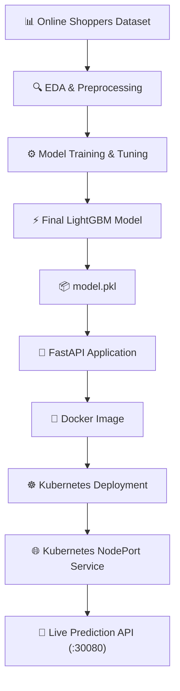
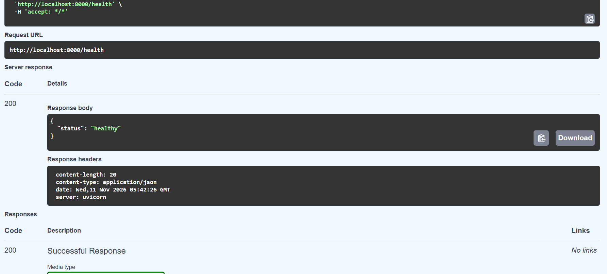
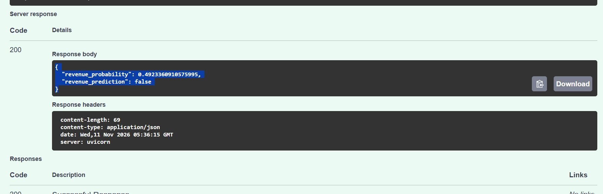
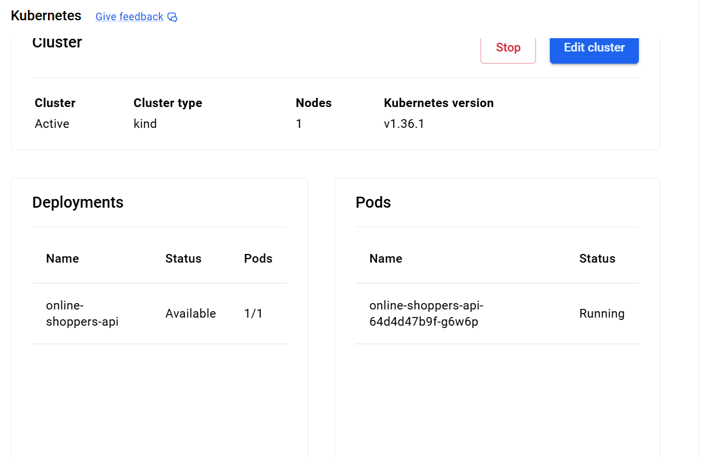
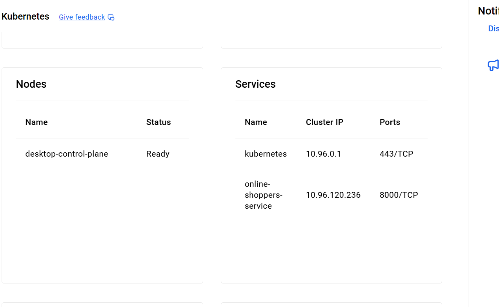
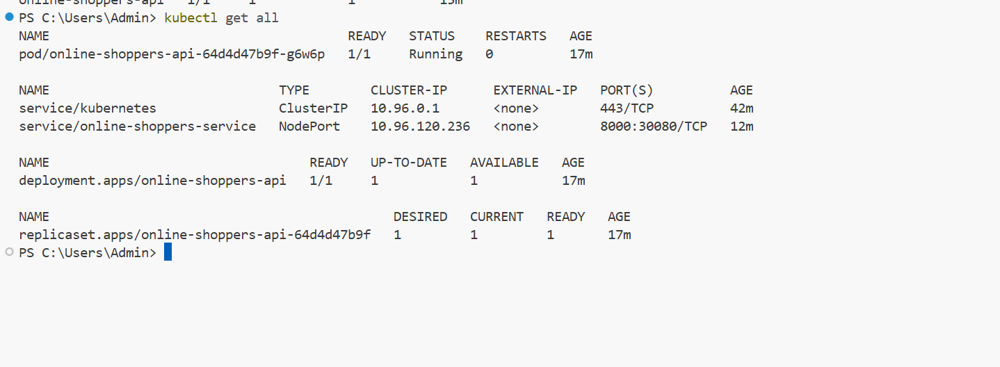

# 🛒 Online Shoppers Purchasing Intention Prediction


> 🎯 **An end-to-end Machine Learning & MLOps project** that predicts whether an online shopping session will convert into a purchase—taking you from raw exploratory data analysis all the way to a containerized **FastAPI** service orchestrated on **Kubernetes**.

---

## 📑 Table of Contents
- [1. Problem Description](#-1-problem-description)
- [2. Dataset](#-2-dataset)
- [3. Project Structure](#-3-project-structure)
- [4. Environment Setup](#-4-environment-setup)
- [5. Exploratory Data Analysis & Preprocessing](#-5-exploratory-data-analysis-and-preprocessing)
- [6. Machine Learning Models](#-6-machine-learning-models)
- [7. Model Comparison & Selection](#-7-model-comparison-and-selection)
- [8. Training Script & Model Export](#-8-training-script-and-model-export)
- [9. FastAPI Web Service](#-9-fastapi-web-service)
- [10. Docker Containerization](#-10-docker-containerization)
- [11. Kubernetes Deployment](#-11-kubernetes-deployment)
- [12. Architecture Diagram](#-12-architecture-diagram)
- [13. Screenshots & Testing Evidence](#-13-screenshots-and-testing-evidence)
- [14. Limitations](#-14-limitations)
- [15. Future Improvements](#-15-future-improvements)
- [16. Technologies Used](#-16-technologies-used)
- [17. Conclusion](#-17-conclusion)

---

## 🎯 1. Problem Description

### 💼 Business Problem
E-commerce websites attract thousands of visitors every day, yet only a small fraction actually complete a purchase. Understanding visitor purchasing behaviour helps businesses identify high-intent customers, optimize website user experiences, and make smarter, data-driven marketing decisions.

The objective of this project is to build a **machine learning classification model** that predicts whether an online shopping session will end in a purchase based on visitor browsing activity, page interactions, and session metadata.

### 🚀 Intended Use
The application ingests real-time session metrics and outputs:
- 📊 **Purchase Probability:** The estimated likelihood that the visitor will buy.
- 🏷️ **Binary Prediction:** Whether the visitor is likely to complete a purchase (`true` / `false`).

The trained model is served via a REST API built with **FastAPI**, packaged into a **Docker** container, and deployed onto a local **Kubernetes** cluster—demonstrating a complete, production-ready ML lifecycle.

---

## 📊 2. Dataset

- **📦 Dataset:** Online Shoppers Purchasing Intention Dataset
- **🏛️ Source:** UCI Machine Learning Repository
- **🔗 Dataset Link:** [UCI ML Repository - Online Shoppers Purchasing Intention Dataset](https://archive.ics.uci.edu/dataset/468/online+shoppers+purchasing+intention+dataset)

### 📋 Dataset Overview

| Metric | Value |
| :--- | :--- |
| **Total Observations** | `12,330` |
| **Total Columns** | `18` |
| **Input Features** | `17` |
| **Target Variable** | `Revenue` |

The target variable `Revenue` indicates session outcome:
- ✅ `True`: The visitor completed a purchase.
- ❌ `False`: The visitor did not complete a purchase.

### ⚖️ Target Distribution

| Class | Observations | Percentage | Visual Split |
| :--- | :--- | :--- | :--- |
| ❌ **False** (No Purchase) | `10,422` | `84.53%` | █████████████████░░░ |
| ✅ **True** (Purchase) | `1,908` | `15.47%` | ███░░░░░░░░░░░░░░░░░ |

> 💡 **Handling Class Imbalance:** Because non-purchasing sessions heavily outnumber purchases, accuracy alone can be misleading. Therefore, **ROC-AUC**, **Precision**, **Recall**, and **F1-score** are prioritized during evaluation.

### 📥 Download Instructions
1. Visit the UCI dataset link provided above.
2. Download the dataset archive.
3. Extract the downloaded files.
4. Place `online_shoppers_intention.csv` directly into the project root directory.

---

## 📁 3. Project Structure

```text
online_shoppers_purchasing_intention_dataset/
│
├── 📂 .venv/                          # Isolated Python virtual environment
├── 📂 screenshots/                    # Deployment and API testing evidence
├── 📄 online_shoppers_intention.csv   # Raw dataset from UCI ML Repository
├── 📓 MidTermProject.ipynb            # EDA, experiments, model training & evaluation
├── 🐍 train.py                        # Final model training & artifact export script
├── 📦 model.pkl                       # Serialized LightGBM model & feature metadata
├── ⚡ app.py                          # FastAPI prediction web service
├── 📋 requirements.txt                # Project Python dependencies
├── 🐳 Dockerfile                      # Instructions to build the Docker image
├── ☸️ deployment.yaml                 # Kubernetes Deployment manifest
├── 🌐 service.yaml                    # Kubernetes NodePort Service manifest
└── 📖 README.md                       # Project documentation
```

### 🗂️ File Descriptions

| File | Purpose |
| :--- | :--- |
| 📓 `MidTermProject.ipynb` | Exploratory data analysis, feature investigation, model experimentation, and evaluation |
| 🐍 `train.py` | Trains the final LightGBM model and saves the serialized artifact |
| 📦 `model.pkl` | Stores the trained model alongside numerical/categorical feature schemas |
| ⚡ `app.py` | FastAPI application exposing health and prediction endpoints |
| 📋 `requirements.txt` | Lists required Python libraries for training and serving |
| 🐳 `Dockerfile` | Defines the container environment and startup command |
| ☸️ `deployment.yaml` | Configures Kubernetes Pod replicas and container specs |
| 🌐 `service.yaml` | Exposes the Kubernetes Deployment via a static `NodePort` |
| 🖼️ `screenshots/` | Visual verification of running pods, scaling, and Swagger UI tests |

---

## ⚙️ 4. Environment Setup

Python 3.9+ is required to run this project locally.

### 4.1 🧪 Create a Virtual Environment
Isolate project dependencies from your global Python installation:
```bash
python -m venv .venv
```

### 4.2 🔌 Activate the Environment
**🪟 Windows PowerShell:**
```powershell
.venv\Scripts\Activate.ps1
```

**🍎 macOS / 🐧 Linux:**
```bash
source .venv/bin/activate
```

### 4.3 📦 Install Dependencies
```bash
pip install -r requirements.txt
```

---

## 🔍 5. Exploratory Data Analysis and Preprocessing

The notebook `MidTermProject.ipynb` walks through comprehensive data exploration and preparation:
- 🔎 Inspecting dataset dimensions, schema, and data types.
- 🧹 Checking for missing or corrupted values.
- 📊 Analyzing target class distribution and session trends.
- 🔢 Studying numerical distributions and categorical breakdowns.
- 🔗 Examining feature correlations and purchasing patterns across visitor segments.
- 🏆 Benchmarking multiple classification algorithms.

### 5.1 🧩 Feature Groups

| Category | Features |
| :--- | :--- |
| **🔢 Numerical Features (10)** | `Administrative`, `Administrative_Duration`, `Informational`, `Informational_Duration`, `ProductRelated`, `ProductRelated_Duration`, `BounceRates`, `ExitRates`, `PageValues`, `SpecialDay` |
| **🏷️ Categorical Features (7)** | `Month`, `OperatingSystems`, `Browser`, `Region`, `TrafficType`, `VisitorType`, `Weekend` |

### 5.2 💡 Key EDA Insights
- ✨ **Clean Data:** The dataset contains **zero missing values** across all 12,330 records.
- 🛍️ **Conversion Rate:** Purchasing sessions account for approximately **15.47%** of all visits.
- 📅 **Seasonal Spike:** **November** recorded the highest traffic volume alongside a strong conversion rate.
- 🆕 **Visitor Behavior:** **New visitors** exhibited a higher observed purchase rate compared to returning visitors.
- 💎 **Top Predictor:** `PageValues` demonstrated the strongest positive relationship with completed purchases.

### 5.3 🌟 Feature Importance Analysis
The final LightGBM model ranked `PageValues` as its dominant predictive signal:

| Rank | Feature | Importance (%) |
| :---: | :--- | :--- |
| 🥇 | **PageValues** | `72.10%` |
| 🥈 | **Month** | `8.42%` |
| 🥉 | **ProductRelated** | `3.57%` |
| 4️⃣ | **BounceRates** | `3.14%` |
| 5️⃣ | **ExitRates** | `3.11%` |

To measure the exact impact of `PageValues`, an ablation experiment was conducted:

| Experiment | Validation ROC-AUC |
| :--- | :--- |
| ✅ **With `PageValues`** | `0.9374` |
| ❌ **Without `PageValues`** | `0.7839` |

> ⚠️ **Production Leakage Note:** Removing `PageValues` drops validation ROC-AUC substantially. In a live e-commerce setting, engineers must verify that `PageValues` is computed in real time *before* checkout occurs so post-purchase data leakage is avoided.

---

## 🤖 6. Machine Learning Models

Five distinct classification algorithms were trained and evaluated to find the best fit for tabular session data:

### 6.1 📈 Logistic Regression
A linear baseline classifier that estimates class probabilities. It established an initial benchmark against which tree-based ensemble models were measured.

### 6.2 🌲 Random Forest
An ensemble bagging algorithm that trains multiple independent decision trees on bootstrapped samples and feature subsets, aggregating their predictions to reduce variance and instability.

### 6.3 🚀 XGBoost
A sequential gradient boosting framework where each tree corrects residual errors from previous trees, incorporating L1/L2 regularization to prevent overfitting.

### 6.4 🐱 CatBoost
A gradient boosting library optimized for categorical features:
- 🔄 **Ordered Boosting:** Reduces prediction shift caused by target leakage during gradient estimation.
- 🏷️ **Native Categorical Handling:** Processes categorical variables without heavy manual preprocessing.
- ⚖️ **Symmetric (Oblivious) Trees:** Applies identical split conditions across every node at a given depth for fast, regularized inference.

**Hyperparameters Explored:** `depth`, `learning_rate`, `l2_leaf_reg`, and `random_strength`. CatBoost achieved a strong validation ROC-AUC of **~0.9373**.

### 6.5 ⚡ LightGBM *(Selected Model)*
Microsoft's high-speed gradient boosting framework built around **leaf-wise tree growth**:
- 🍃 Unlike traditional level-wise growth, LightGBM splits the specific leaf yielding the greatest loss reduction—boosting accuracy while requiring depth/leaf constraints to prevent overfitting.

| Hyperparameter | Role |
| :--- | :--- |
| `n_estimators` | Number of boosting rounds |
| `learning_rate` | Step size shrinkage applied to each tree |
| `max_depth` | Maximum depth allowed per tree |
| `num_leaves` | Maximum number of terminal leaves per tree |
| `min_child_samples` | Minimum data points required inside a leaf |

---

## 🏆 7. Model Comparison and Selection

All candidate models were benchmarked on the validation set using **ROC-AUC**:

| Model | Validation ROC-AUC | Status |
| :--- | :---: | :--- |
| Logistic Regression | `0.8990` | Baseline |
| Random Forest | `0.9333` | Evaluated |
| XGBoost | `0.9338` | Evaluated |
| CatBoost | `0.9373` | Runner-up |
| **LightGBM** | **`0.9374`** | **🥇 Selected Final Model** |

**LightGBM** achieved the highest validation ROC-AUC (edging out CatBoost) and was chosen for final evaluation on the held-out test set.

### 7.1 🛠️ Final LightGBM Configuration
```python
best_lgb_params = {
    "n_estimators": 50,
    "learning_rate": 0.05,
    "max_depth": 5,
    "num_leaves": 31,
    "min_child_samples": 10,
    "random_state": 1,
    "n_jobs": -1,
    "verbosity": -1
}
```

### 7.2 🎯 Final Test Set Results

| Metric | Score |
| :--- | :---: |
| **ROC-AUC** | **`0.9398`** |
| **Accuracy** | **`0.9088`** |
| **Precision** | **`0.76`** |
| **Recall** | **`0.60`** |
| **F1-score** | **`0.67`** |

**🧮 Confusion Matrix:**
```text
[[2010    74]
 [ 151   231]]
```

### 7.3 📖 Metric Definitions
- **ROC-AUC:** Evaluates the model's ability to separate buyers from non-buyers across all probability thresholds.
- **Accuracy:** Overall percentage of correct predictions.
- **Precision:** Out of all sessions predicted as purchases, how many actually converted?
- **Recall:** Out of all actual purchasing sessions, how many did the model successfully catch?
- **F1-score:** Harmonic mean balancing Precision and Recall.

---

## 🏋️ 8. Training Script and Model Export

While `MidTermProject.ipynb` documents the experimentation workflow, `train.py` automates reproducible training for production deployment.

### ▶️ Run the Training Script
```bash
python train.py
```

Executing `train.py` trains the final LightGBM model and packages everything into `model.pkl`, bundling:
1. 🤖 The trained LightGBM classifier.
2. 🔢 Numerical feature names.
3. 🏷️ Categorical feature names.
4. 📚 Valid category mappings learned during training (preventing schema drift during inference).

### 📓 Reproducing the Notebook
Open `MidTermProject.ipynb` in **Jupyter Notebook** or **VS Code**, select the `.venv` kernel, and run all cells top-to-bottom.

---

## ⚡ 9. FastAPI Web Service

**FastAPI** powers the low-latency REST API that serves real-time purchase predictions.

### 9.1 🌐 Core API Components
- **Endpoints:**
  - `GET /` — Root welcome & status check.
  - `GET /health` — Service liveness probe.
  - `POST /predict` — Accepts session JSON and returns purchase probability + binary prediction.
- **🛡️ Pydantic Validation:** The `ShopperData` schema enforces strict data types and validates that categorical inputs match known training categories before touching the model.
- **🦄 Uvicorn:** High-performance ASGI server running the FastAPI application.

### 9.2 🔄 Inference Pipeline
```text
Client JSON Request ──▶ Pydantic Validation ──▶ Pandas DataFrame ──▶ Categorical Alignment ──▶ Feature Ordering ──▶ LightGBM Inference ──▶ JSON Response
```

### 9.3 🚀 Run the API Locally
```bash
uvicorn app:app --reload
```
- **📘 Swagger UI Docs:** `http://127.0.0.1:8000/docs`
- **💓 Health Check:** `http://127.0.0.1:8000/health`
- **🎯 Prediction Endpoint:** `POST /predict`

### 9.4 📡 Example Prediction Request
```bash
curl -X POST "http://localhost:8000/predict" \
-H "Content-Type: application/json" \
-d '{
  "administrative": 5,
  "administrative_duration": 120.0,
  "informational": 3,
  "informational_duration": 80.0,
  "productrelated": 45,
  "productrelated_duration": 1800.0,
  "bouncerates": 0.01,
  "exitrates": 0.02,
  "pagevalues": 35.5,
  "specialday": 0.0,
  "month": "nov",
  "operatingsystems": 2,
  "browser": 2,
  "region": 1,
  "traffictype": 2,
  "visitortype": "returning_visitor",
  "weekend": true
}'
```

**📥 Example JSON Response:**
```json
{
  "revenue_probability": 0.4923360910575995,
  "revenue_prediction": false
}
```
*(Predictions use a default decision threshold of `0.5`.)*

---

## 🐳 10. Docker Containerization

**Docker** encapsulates the FastAPI application, model artifact, and system libraries into a portable container image so it runs identically across any environment.

### 10.1 🧱 Key Concepts
- **🖼️ Docker Image:** Read-only blueprint containing application code, Python packages, and runtime instructions.
- **📦 Docker Container:** Isolated, running instance of the Docker image.
- **📄 Dockerfile:** Step-by-step build recipe for assembling the image.

### 10.2 📝 Dockerfile Breakdown

| Instruction | Purpose |
| :--- | :--- |
| `FROM` | Pulls the official slim Python base image |
| `WORKDIR` | Sets `/app` as the active container directory |
| `RUN` | Installs `libgomp1` and Python packages from `requirements.txt` |
| `COPY` | Copies `app.py`, `model.pkl`, and supporting code into the container |
| `EXPOSE` | Documents container port `8000` |
| `CMD` | Launches Uvicorn to serve the FastAPI app |

> 📌 **Why `libgomp1`?** LightGBM relies on the OpenMP runtime library (`libgomp1`) for multi-threaded execution inside Linux containers.

### 10.3 🔨 Build the Image
Ensure **Docker Desktop** is running, then build the image:
```bash
docker build -t online-shoppers-api .
```

### 10.4 ▶️ Run the Container
```bash
docker run -d -p 8000:8000 --name shoppers-api online-shoppers-api
```
Maps host port `8000` to container port `8000`.

### 10.5 🧪 Test the Containerized API
- **📘 Swagger UI:** `http://localhost:8000/docs`
- **💓 Health Check:** `http://localhost:8000/health`

### 10.6 🛑 Stop & Clean Up
```bash
docker stop shoppers-api
docker rm shoppers-api
```
*(Your `online-shoppers-api` image remains cached locally for future runs.)*

---

## ☸️ 11. Kubernetes Deployment

**Kubernetes** automates container deployment, self-healing, networking, and horizontal scaling on a local cluster provided by Docker Desktop.

### 11.1 🏗️ Cluster Architecture
- **🌐 Cluster:** Local single-node Kubernetes cluster managed by Docker Desktop (`kind` provisioning).
- **🖥️ Node:** Worker/control-plane machine (`desktop-control-plane`) hosting workloads.
- **🫛 Pod:** Smallest deployable Kubernetes unit encapsulating the FastAPI container.
- **🚀 Deployment:** Declares desired Pod state (`replicas: 1`) and manages updates.
- **🔁 ReplicaSet:** Monitors running Pods and automatically replaces any that crash.
- **🔌 Service (`NodePort`):** Provides a stable network endpoint and exposes the app externally on static port **`30080`**.

### 11.2 📄 Deployment Manifest (`deployment.yaml`)
- `replicas: 1` — Maintains one active application Pod.
- `selector` & `labels` — Links Deployment to Pods via `app: online-shoppers-api`.
- `image: online-shoppers-api:latest` — Uses the locally built Docker image.
- `imagePullPolicy: IfNotPresent` — Prevents unnecessary external registry pulls.
- `containerPort: 8000` — Exposes Uvicorn's listening port inside the Pod.

### 11.3 🌐 Service Manifest (`service.yaml`)
- `type: NodePort` — Exposes the service on every cluster node's IP at a static port.
- `selector: app: online-shoppers-api` — Routes external traffic to matching Pods.
- `port: 8000` / `targetPort: 8000` — Forwards service traffic directly to container port `8000`.
- `nodePort: 30080` — External port accessible at `http://localhost:30080`.

### 11.4 🚦 Start the Kubernetes Cluster
1. Open **Docker Desktop** ➡️ **Settings** ➡️ **Kubernetes**.
2. Check **Enable Kubernetes** and click **Apply & Restart**.
3. Verify the cluster node is ready:
```bash
kubectl get nodes
```

### 11.5 🚀 Deploy to Kubernetes
```bash
kubectl apply -f deployment.yaml
kubectl apply -f service.yaml
```

### 11.6 🔍 Verify Resources
```bash
kubectl get pods
kubectl get deployments
kubectl get services
kubectl get all
```

### 11.7 📈 Horizontal Scaling
Scale up to **2 replicas** to handle higher traffic:
```bash
kubectl scale deployment online-shoppers-api --replicas=2
kubectl get pods
```

Scale back down to **1 replica**:
```bash
kubectl scale deployment online-shoppers-api --replicas=1
```

### 11.8 🧪 Test the Kubernetes Endpoint
- **📘 Swagger UI:** `http://localhost:30080/docs`
- **💓 Health Check:** `http://localhost:30080/health`
- **🎯 Prediction:** Send a `POST` request to `http://localhost:30080/predict`.

---

## 🗺️ 12. Architecture Diagram



---

## 📸 13. Screenshots and Testing Evidence

The `screenshots/` folder captures proof of deployment, scaling, and live API testing:

### ⚡ FastAPI Health & Status


### 🎯 FastAPI Prediction Response (Swagger UI)


### ☸️ Kubernetes Deployment Status


### 📈 Kubernetes Horizontal Scaling (2 Replicas)


### 🖥️ Kubernetes Cluster Resources Overview


---

## ⚠️ 14. Limitations

- 📉 **Domain Generalization:** Historical session data from one e-commerce platform may not capture browsing habits across all retail verticals.
- ⚖️ **Class Imbalance:** Purchasing sessions represent only `15.47%` of the dataset, requiring careful threshold consideration.
- 🎚️ **Fixed Threshold:** The binary decision boundary is currently hardcoded at `0.5` rather than tuned to business cost-benefit ratios.
- 💻 **Local Cluster:** Orchestration was validated on a local Docker Desktop Kubernetes cluster rather than a multi-node cloud environment.
- ⏱️ **Real-Time Feature Availability:** `PageValues` drives `72.10%` of model importance; production pipelines must guarantee this metric is available prior to checkout without data leakage.

---

## 🔮 15. Future Improvements

- 🔄 **K-Fold Cross-Validation:** Implement stratified cross-validation for even more robust performance estimates.
- 🎯 **Business-Driven Threshold Tuning:** Optimize the classification cutoff using Precision-Recall curves aligned with marketing ROI.
- 📊 **Drift & Model Monitoring:** Track feature distributions and prediction drift over time using tools like Evidently AI or Prometheus.
- ☁️ **Cloud Kubernetes Deployment:** Deploy the containerized service to managed cloud clusters (**AWS EKS**, **GCP GKE**, or **Azure AKS**).
- 🧪 **CI/CD & Automated Testing:** Add `pytest` unit/integration tests and GitHub Actions pipelines for automated image builds.
- 📝 **Structured Observability:** Enhance FastAPI with structured JSON logging, request tracing, and custom exception handlers.

---

## 🛠️ 16. Technologies Used

| Category | Technology | Purpose |
| :--- | :--- | :--- |
| **Core Language** | 🐍 **Python** | Primary programming language |
| **Data Processing** | 🐼 **Pandas & NumPy** | Data manipulation and numerical computing |
| **Machine Learning** | 🤖 **Scikit-learn** | Preprocessing, splitting, and evaluation metrics |
| **Gradient Boosting** | 🚀 **XGBoost & CatBoost** | Comparative model experimentation |
| **Selected Model** | ⚡ **LightGBM** | Final high-performing gradient boosting classifier |
| **Visualization** | 📊 **Matplotlib & Seaborn** | Exploratory data visualization |
| **Experimentation** | 📓 **Jupyter Notebook** | Interactive EDA and prototyping |
| **Web Framework** | ⚡ **FastAPI & Pydantic** | High-speed REST API and strict schema validation |
| **ASGI Server** | 🦄 **Uvicorn** | Asynchronous web server for FastAPI |
| **Containerization** | 🐳 **Docker** | Portable application packaging |
| **Orchestration** | ☸️ **Kubernetes & kubectl** | Automated container deployment, scaling, and networking |

---

## 🏁 17. Conclusion

This project showcases an end-to-end machine learning engineering workflow—from raw data exploration to containerized microservice deployment. After benchmarking five classification algorithms, **LightGBM** emerged as the top performer with a test **ROC-AUC of `0.9398`**. By wrapping the serialized model in **FastAPI**, packaging it with **Docker**, and orchestrating it via **Kubernetes**, the solution bridges the gap between experimental data science and scalable production software.
